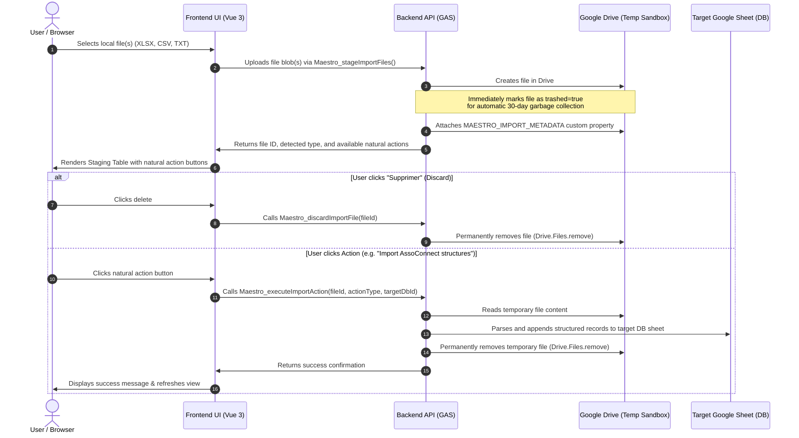

# Import Process Specification

## 1. Overview & Motivations

**Maestro** interfaces with multiple disparate external systems (such as **AssoConnect**, **Application Collecte**, **VIF**, and **AMS**) to ingest regional branch data. Historically, data imports required manual file handling and rigid, isolated upload interfaces.

To radically simplify the user experience and eliminate cognitive friction for branch operators, Maestro implements a **Unified Two-Stage Intelligent Import Workflow**:
1. **Frictionless Ingestion & Immediate Sandboxing**: As soon as a user selects one or more files from their computer, the application instantly uploads them to Google Drive and moves them to the trash (`trashed = true`). This guarantees automatic permanent purge by Google Drive if the session is abandoned, while establishing an immediate server-side handle.
2. **Intelligent Introspection & Natural Action Mapping**: Instead of forcing the user to know what kind of file they are uploading or choosing complex menu options beforehand, Maestro inspects the file contents (structure, sheets, columns, and signatures) and presents natural, human-readable actions (e.g., *"Import AssoConnect structures"*, *"Import Collecte inscriptions"*).
3. **Resumability & State Metadata**: Custom Google Drive file properties (`MAESTRO_IMPORT_METADATA`) are attached to temporary files, allowing the import context and analysis state to persist and be resumed as long as the file exists in the user's Google Drive.
4. **Explicit User Control**: Users are presented with clear semantic options: execute the suggested action, or explicitly discard/delete the temporary file if a mistake was made.

---

## 2. User Interface (UI) Design

### 2.1 The Import Tool View (`Gestion des Importations`)
The import page consists of a clean dropzone / file picker component followed by a dynamic staging table.

#### **Stage 1: File Selection & Instant Sandbox Upload**
- **Action**: User clicks *"Sélectionner des fichiers"* (Select files) or drags and drops files (XLSX, CSV, TXT) into the browser dropzone.
- **Immediate Feedback**: A loading spinner appears next to each selected file. Under the hood, the frontend uploads each file to Google Drive and sets its status to trashed.

#### **Stage 2: Staging & Natural Action Dispatch**
Once uploaded and inspected, each file appears in the **Staging Table** with its detected type, metadata, and available actions.

| Fichier (File Name) | Type Détecté (Detected Type) | Actions Disponibles (Available Actions) | Statut / Contrôles |
| :--- | :--- | :--- | :--- |
| `export_structures_2026.xlsx` | AssoConnect (Structures) | • **Import AssoConnect structures** | [ Exécuter ] [ Supprimer ] |
| `inscriptions_collec.xlsx` | Application Collecte (Inscriptions) | • **Import Collecte (Inscriptions)** | [ Exécuter ] [ Supprimer ] |
| `unknown_file.txt` | Inconnu / Non reconnu | • *Aucune action disponible* | [ Supprimer ] |

- **Natural Action Labels**: Actions are described in plain business terms (e.g., *"Import AssoConnect structures"*), removing technical jargon.
- **Explicit Dismissal (`Supprimer`)**: If the user realizes they uploaded the wrong file, clicking *"Supprimer"* immediately purges the temporary file permanently from Google Drive without executing any database import.

---

## 3. Technical Implementation

### 3.1 Temporary File Lifecycle & Hygiene
1. **Upload & Trash Staging**:
   - Files received via `google.script.run` are stored as temporary blobs in Google Drive.
   - The file is immediately updated with `trashed: true` via Drive API v3 to ensure Google Drive's native garbage collection purges it automatically after 30 days if left unhandled.
2. **Custom File Properties**:
   - Metadata (such as detected schema, checksum, or original filename) is stored using Drive custom properties (`MAESTRO_IMPORT_METADATA`).
3. **Permanent Cleanup**:
   - Once an import action successfully completes (or the user explicitly deletes the staging item), the temporary file is permanently deleted via `Drive.Files.remove(fileId)`.

### 3.2 File Introspection Engine
The backend inspects uploaded files based on rules defined per data source:
- **AssoConnect**: Identifies XLSX spreadsheets containing a sheet named `"Export 1"` and inspects column headers (e.g., distinguishing structures vs. members based on primary key signatures).
- **Application Collecte / VIF / AMS**: Inspects sheet names, file extensions, and header structures.

---

## 4. Workflow Mermaid Diagram

